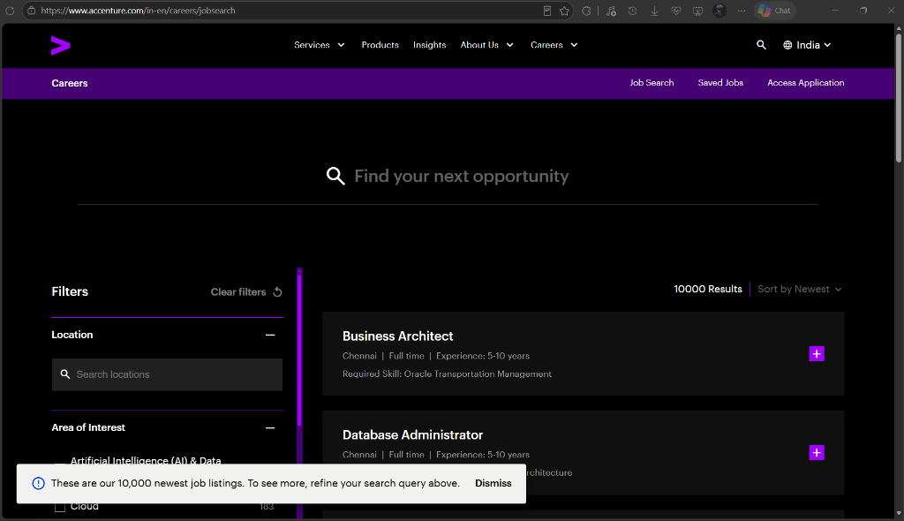
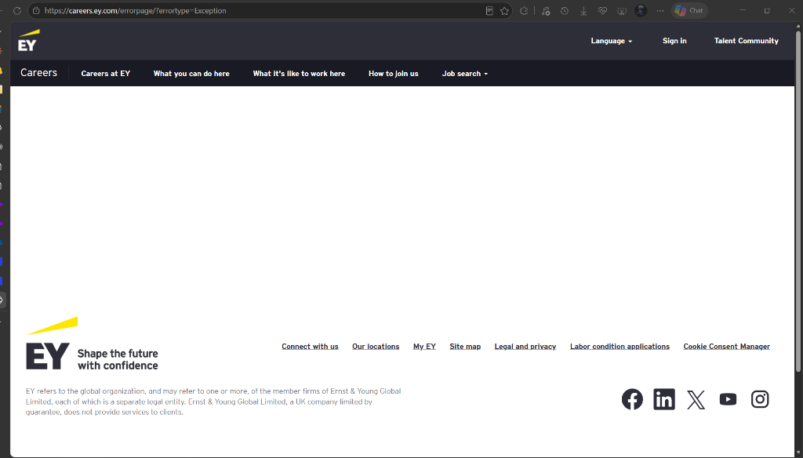
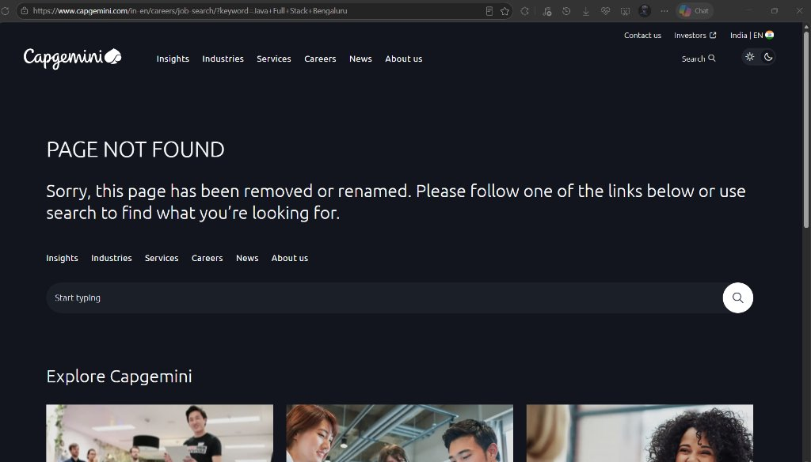
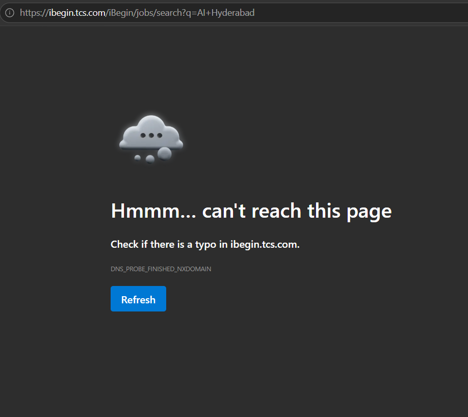

# 🧭 Local AI Job Finder — Desktop Edition

[](https://github.com/aswin/local-job-finder/actions)


A modern, offline-first native desktop application for tech job discovery, multi-platform ATS crawling (**Workday**, **Greenhouse**, **Lever**, and **Direct Enterprise Portals**), TF-IDF resume match scoring, application tracking, market analytics, and local AI career assistance via LM Studio.

Pre-loaded with **4,960+ verified tech jobs** across **400+ top employers**.

---

## 📸 Screenshots & Visual Walkthrough

### 1. Main Job Discovery & Intelligent Filter Grid
> Comprehensive view featuring live metric counters, ⚠️ Missed Jobs alert badge, TF-IDF resume matching, and an aligned 4-column filter grid.


### 2. Market Insights & In-Demand Skills Analytics
> Embedded Matplotlib analytics showing top hiring employers, active vs. missed opportunities pipeline, tech role breakdowns, top cities, most in-demand skills, and ATS platform distribution.


### 3. Detailed Job Card & Resume Skill Matching
> Displays matched skills, missing skills, direct ATS badge (`🏢 Direct ATS Board`, `🌐 Company Career Portal`), and one-click application links (`Open on Workday ↗`).


### 4. 🤖 Local AI Career Assistant (LM Studio / Qwen3)
> Real-time LLM status toolbar, active model switcher, resume-grounded career advice, and 8-question targeted interview preparation generator.


---

## ⚡ Quick Start Options

### Option 1: Standalone Windows Executable (No Python Required)
Run the application directly without installing Python, Git, or dependencies:
1. Download **`LocalJobFinder-Windows-Portable.zip`** from the `dist/` directory or Releases.
2. Extract the ZIP to any folder.
3. Double-click **`LocalJobFinder.exe`** (or `Launch-LocalJobFinder.bat`).

*(All assets, dependencies, and SQLite database are self-contained and pre-configured).*

---

### Option 2: One-Click Script Launch (Windows with Python)
Double-click `run.bat` or run in PowerShell:
```powershell
.\run.ps1
```
*(The launcher automatically resolves installed Python 3.14/3.12/3.11 runtimes and bypasses Windows Store aliases).*

---

### Option 3: Developer Command Line
```powershell
cd tkinder
pip install -r requirements.txt
python app.py
```

---

## 📦 Pinned Dependencies & Environments

All production and development dependencies are strictly pinned to ensure reproducible builds:

### Production (`requirements.txt`)
```text
requests==2.32.3
urllib3==2.2.3
pandas==2.2.3
numpy==2.1.3
scikit-learn==1.5.2
scipy==1.14.1
pymupdf==1.24.14
python-docx==1.1.2
matplotlib==3.9.2
pillow==11.0.0
```

### Development & Packaging (`requirements-dev.txt`)
```text
-r requirements.txt
pytest==8.3.3
pluggy==1.5.0
iniconfig==2.0.0
pyinstaller==6.11.0
altgraph==0.17.4
pefile==2023.2.7
```

To install the complete developer and test harness:
```powershell
pip install -r requirements-dev.txt
```

---

## 🏢 ATS Platform & Employer Coverage Matrix

The database is pre-populated with **4,968 active listings** across **403 distinct employers**:

| ATS / Platform Type | Platform Label | Example Employers | Active Listings in DB |
| :--- | :--- | :--- | :---: |
| **Workday Career Boards** (`🏢`) | `Workday` | **Airbus**, **Nvidia**, **Mastercard**, **CrowdStrike**, **Adobe**, **Salesforce**, **Autodesk**, **HP**, **eBay**, **Workday**, **Target** | **420** |
| **Greenhouse Boards** (`🏢`) | `Greenhouse` | **Databricks**, **MongoDB**, **Elastic**, **Stripe**, **Swiggy**, **Razorpay**, **CRED**, **Meesho**, **Postman**, **BrowserStack**, **Figma**, **Notion**, **Datadog**, **Cloudflare** | **3,404** |
| **Lever Boards** (`🏢`) | `Lever.co` | **Spotify**, **PhonePe**, **Groww**, **Freshworks**, **Palantir**, **Docker**, **Zeta**, **Juspay**, **Acko**, **Lenskart** | **503** |
| **Company Career Portals** (`🌐`) | `Career Page` | **Accenture**, **TCS (Tata Consultancy Services)**, **Capgemini**, **KPMG**, **EY (Ernst & Young)** | **17** |
| **Public Tech Feeds** (`⚡`) | `Arbeitnow` | Global engineering & remote listings | **274** |
| **Remote Job Feeds** (`⚡`) | `Jobicy` | Remote developer & tech positions | **200** |
| **Remote Board** (`⚡`) | `Remote OK` | Worldwide remote engineering roles | **137** |
| **Public Remote Feed** (`⚡`) | `Remotive` | Distributed engineering & DevOps roles | **13** |
| **Total Database Volume** | — | **403 Distinct Employers** | **4,968** |

---

## 🩺 Scraper Health Diagnostics & Monitoring

When job boards update their endpoints or alter their JSON schema, scrapers can silently break or return empty feeds. The built-in **Source Health & Diagnostic Engine** proactively tests all configured endpoints:

### 1. In-App GUI Health Monitor
Navigate to **⚙️ Sources & Backups** tab and click **`🩺 Run Source Health Check`**:
- Probes all configured Workday, Greenhouse, Lever, and feed endpoints concurrently.
- Surfaces visual status pills: `🟢 Healthy`, `🟡 Warning`, and `🔴 Broken`.
- Reports HTTP status codes, latency in milliseconds, and job count found.
- Displays root-cause diagnosis (e.g. `HTTP 404 - Board moved or slug updated`, `HTTP 403 Forbidden`, `Malformed non-JSON HTML redirect`).
- One-click **`📋 Copy Markdown Report`** button to share findings with the team.

### 2. Command Line Diagnostics
Run diagnostic probes directly from the terminal or CI pipeline:
```powershell
# Quick sample probe
python -m src.source_health

# Full audit across all 50+ configured company endpoints with Markdown output
python -m src.source_health --all --markdown
```

---

## 🧪 Comprehensive Unit Test Suite

The test suite covers TF-IDF ranking, skill extraction, resume parsers, heuristic classifiers, and source health diagnostics with 100% passing tests:

```powershell
# Run all unit tests
pytest tests/ -v
```

### Test Coverage Highlights
- **`tests/test_matcher.py`**:
  - Word boundary isolation (e.g. ensures `"go"` does not match inside `"good"` or `"algorithm"`).
  - Multi-word skill extraction (`"machine learning"`, `"system design"`, `"prompt engineering"`).
  - Case insensitivity and punctuation handling (`"C++"`, `"C#"`).
  - TF-IDF cosine similarity and skill intersection calculations.
- **`tests/test_parsers.py`**:
  - Resume extraction across `.txt`, `.docx`, and `.pdf` formats.
  - Zero-dependency XML fallback parser for `.docx` when `python-docx` is absent.
  - Heuristic classifiers for 11 technical roles, experience tiers, work arrangements, and platforms.
  - Outdated job (>30 days) and missed job identification logic.
- **`tests/test_source_health.py`**:
  - Mocks HTTP 200, 404 Not Found, 403 Forbidden, 500 Server Error, timeouts, and non-JSON payloads.
  - Verifies healthy, warning, and broken status classifications and remediation suggestions.

---

## ⚙️ GitHub Actions CI Pipeline

Continuous Integration is automated via [`.github/workflows/ci.yml`](file:///c:/Users/Aswin%20A/local-job-finder/local-job-finder-company-discovery/.github/workflows/ci.yml):
- **Cross-Platform Matrix**: Runs on both `ubuntu-latest` and `windows-latest`.
- **Multi-Version Python**: Tests against Python `3.11`, `3.12`, and `3.13`.
- **Automated Steps**:
  1. Installs pinned dependencies.
  2. Executes `pytest` unit test suite.
  3. Executes `src.source_health` diagnostic probe.

---

## 🔨 Building the Standalone Executable (.exe)

To compile the standalone Windows portable distribution locally:
```powershell
python build_exe.py
```
This produces:
- `dist/LocalJobFinder/LocalJobFinder.exe` — Standalone native executable.
- `dist/LocalJobFinder-Windows-Portable.zip` — Portable distribution package ready for sharing.

---

## 📁 Repository Layout

```text
tkinder/
├── app.py                     # Main Tkinter desktop application
├── build_exe.py               # Automated PyInstaller build & packaging script
├── run.bat                    # One-click Windows batch launcher
├── run.ps1                    # One-click PowerShell launcher
├── requirements.txt           # Pinned production dependencies
├── requirements-dev.txt       # Pinned development, test, and packaging tools
├── pytest.ini                 # Pytest configuration
├── README.md                  # Comprehensive documentation
├── assets/                    # Screenshots and UI walkthrough images
├── config/
│   └── companies.json         # Configured Workday, Greenhouse, and Lever tokens
├── data/
│   ├── jobs.sqlite3           # SQLite database (4,960+ jobs & tracking history)
│   ├── backups/               # Automated daily SQLite snapshots
│   └── .mplcache/             # Local cache for Matplotlib
├── src/
    ├── database.py            # SQLite schema, migrations, transactions, backups
    ├── dialogs.py             # Filter modals, resume text editor, source health dialog
    ├── helpers.py             # Platform inference, heuristics, badges, role/exp parsers
    ├── job_sources.py         # ATS scrapers (Workday, Greenhouse, Lever) & public feeds
    ├── llm.py                 # LM Studio OpenAI client, model fetcher, & connection tester
    ├── matcher.py             # TF-IDF vectorizer & technical skill matcher
    ├── resume_parser.py       # Universal PDF, DOCX, TXT parser with fallback engine
    ├── source_health.py       # Scraper health monitor & broken endpoint diagnostics
    └── ui_theme.py            # Modern ttk palette, platform pills, and custom styling
└── tests/
    ├── conftest.py            # Pytest path and environment fixtures
    ├── test_matcher.py        # TF-IDF and skill extraction tests
    ├── test_parsers.py        # Resume parser and helper inference tests
    └── test_source_health.py  # Health monitor and diagnostics tests
```
