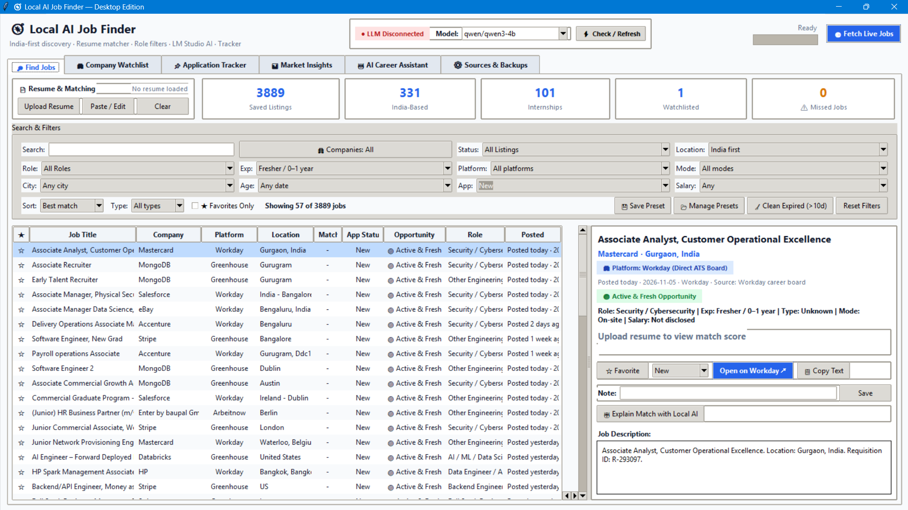
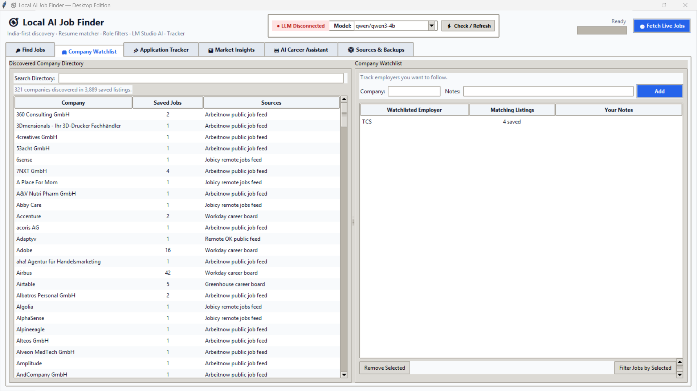
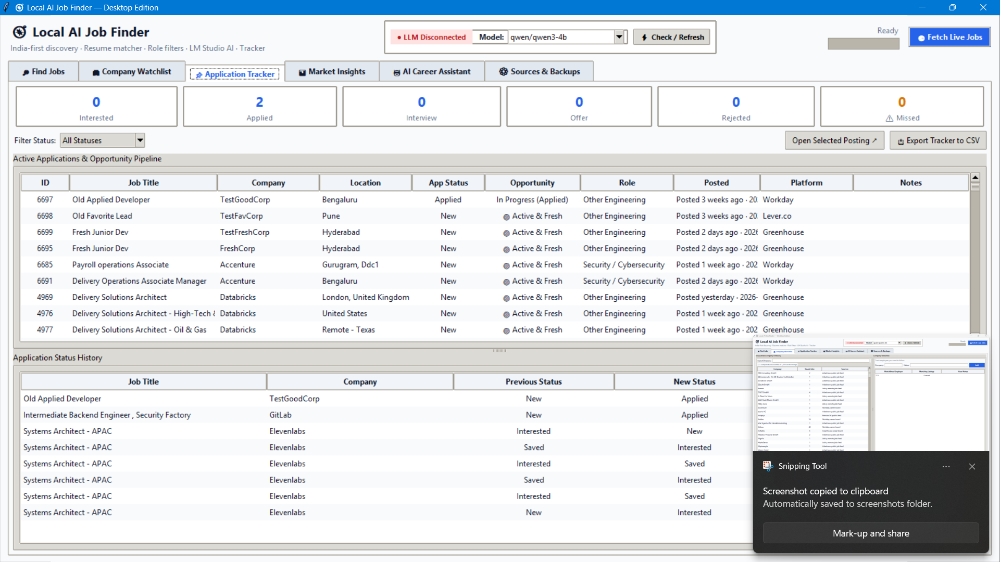
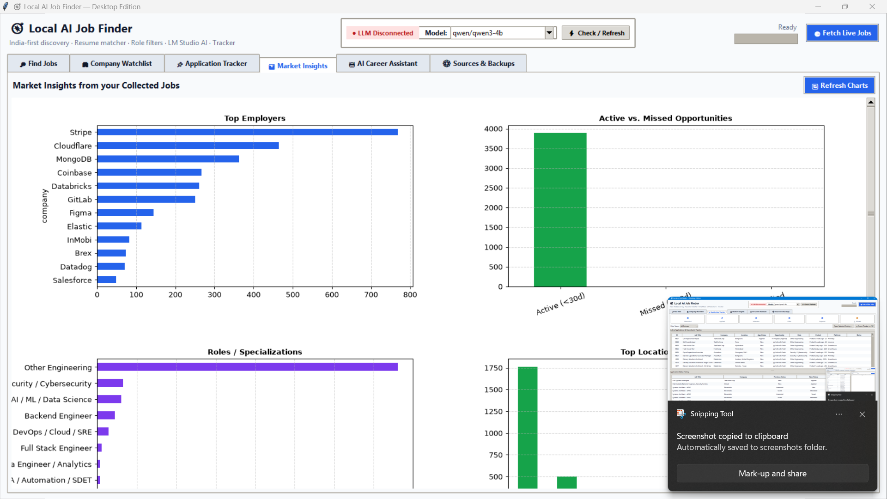
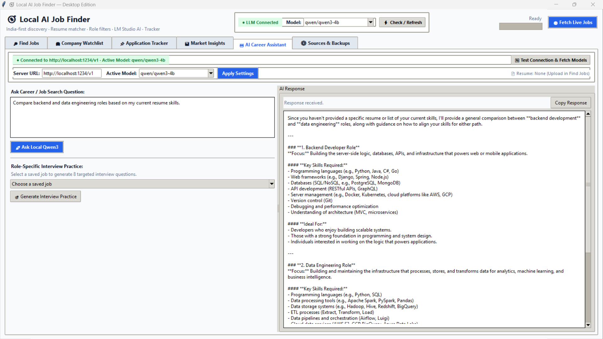
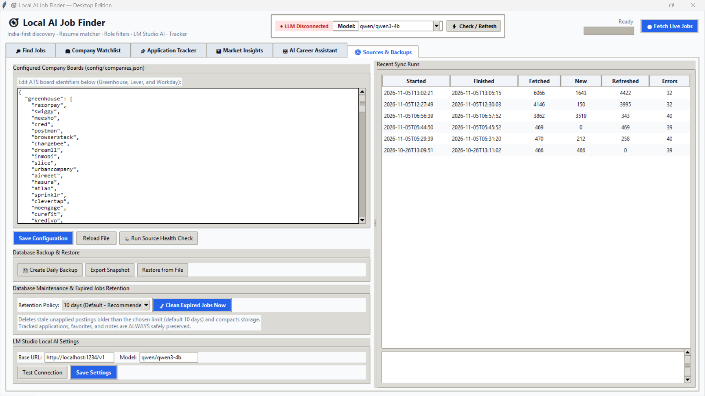

# 🧭 Local AI Job Finder — Desktop Edition

[](https://github.com/ASWINa1636/Job_finder/actions)


A modern, high-performance, offline-first native desktop application for tech job discovery, multi-platform ATS crawling (**Workday**, **Greenhouse**, **Lever**, and **Direct Enterprise Portals**), TF-IDF resume skill matching, job application lifecycle tracking, embedded Matplotlib market analytics, and 100% private local AI career assistance via LM Studio.

Pre-loaded with **3,880+ verified tech jobs** across **400+ top employers** (including Airbus, Nvidia, Accenture, TCS, Capgemini, Databricks, Stripe, Swiggy, and Razorpay).

---

## 📸 Screenshots & Visual Walkthrough

Explore the primary capabilities of the application through the dedicated tabs:

### 1. 🔍 Find Jobs — Intelligent Discovery & Filter Grid
> Comprehensive job exploration interface featuring real-time metric counters, ⚠️ Missed Jobs alert badges, TF-IDF resume match scores, direct ATS requisition links, and a unified 4-column filter grid.


- **Unified Multi-Facet Filters**: Filter instantaneously across Keywords, Locations / Cities, 11 Technical Role specializations (Data & AI, Backend, Full Stack, DevOps, Mobile, QA, Security, UI/UX), Experience Tiers (Entry / Fresher, Mid, Senior / Lead, Executive), Work Modes (Remote, Hybrid, Onsite), Job Types (Full-Time, Internship, Contract), and ATS Sources.
- **Direct Requisition Links**: Direct access badges (`🏢 Direct ATS Board`, `🌐 Company Career Portal`) taking you straight to official job postings on Workday, Greenhouse, Lever, TCS, Accenture, Capgemini, and EY without intermediaries.
- **Resume Match Scoring**: Upload your resume (`.pdf`, `.docx`, `.txt`) or paste text to compute cosine similarity scores and inspect matched vs. missing skills chips on every job card.
- **Quick Maintenance**: One-click `🧹 Clean Expired (>10d)` button to purge stale listings while preserving all applied and saved jobs.

---

### 2. 🏢 Company Watchlist — Target Employer Monitoring
> Track tier-1 tech companies, multinational enterprises, and high-growth startups with custom notes and live opening counters.


- **Dedicated Company Tracking**: Pin priority companies (e.g. Google, Microsoft, Airbus, Nvidia, TCS, Accenture) to your watchlist.
- **Live Openings Counter**: Automatically aggregates active job count in the database for each watched company.
- **Custom Research Notes**: Store notes on hiring managers, interview formats, salary bands, and referral contacts directly in SQLite.

---

### 3. 📌 Application Tracker — Full Lifecycle Kanban & Table
> Manage your active job search pipeline with end-to-end status tracking, stage transitions, recruiter notes, and automated timestamp auditing.


- **Pipeline Stages**: Categorize applications across `Applied`, `Interview`, `Offer`, `Rejected`, and `Saved`.
- **Status Audit Timeline**: Every status update automatically appends an entry to the `status_history` table with exact timestamps.
- **Safe Retention Shield**: Tracked applications and annotated jobs are permanently protected from automated retention cleanup routines.
- **Direct Application Links**: Quickly open requisition links directly from the tracking table to check application status on company portals.

---

### 4. 📊 Market Insights — Real-Time Hiring & Skill Analytics
> Embedded Matplotlib analytical suite delivering 6 synchronized charts computed asynchronously in the background for zero-latency UI interactions.


- **Top Hiring Employers**: Horizontal bar chart visualizing the most active hiring organizations in the market.
- **Active vs. Missed Opportunities Pipeline**: Color-coded comparison of fresh listings (<30 days), missed postings (>30 days), and submitted applications.
- **Role Specializations**: Distribution of openings across AI/ML, Cloud/DevOps, Full Stack, Data Engineering, and Cybersecurity.
- **Top Tech Locations**: Geographical breakdown highlighting major tech hubs (Bengaluru, Hyderabad, Pune, Chennai, Gurgaon, Mumbai, and Remote).
- **In-Demand Technical Skills**: Automated frequency analysis parsing technical keywords (Python, Docker, Kubernetes, AWS, React, SQL, PyTorch) from job descriptions.
- **Platform & ATS Source Distribution**: Proportion of jobs sourced from Workday, Greenhouse, Lever, and direct enterprise portals.

---

### 5. 🤖 AI Career Assistant — 100% Private Local LLM
> Real-time integration with LM Studio running local open-weight models (Qwen 2.5/3, Llama 3, Mistral, Gemma 2, Phi). Zero external API calls, zero subscription fees, and complete data privacy.


- **Connection Health Bar**: Real-time status pill (`● LLM Connected` / `● LLM Disconnected`), dynamic model discovery, and latency monitor.
- **4 Specialized Career Modes**:
  1. **Resume & Match Analysis**: In-depth critique of resume strengths, alignment with selected job requisitions, and concrete bullet-point improvements.
  2. **8-Question Targeted Interview Prep**: Generates 8 realistic technical, architectural, and behavioral interview questions customized to the target employer.
  3. **Custom Tailored Cover Letter**: Drafts a compelling, authentic cover letter highlighting your exact matching skills and relevant project achievements.
  4. **Freeform Career Coaching**: Interactive chat for salary negotiation strategies, resume positioning, and skill development roadmaps.

---

### 6. ⚙️ Sources & Backups — Health Diagnostics & Retention Engine
> Operational center for monitoring scraper health, executing automated database purges, and backing up local SQLite records.


- **Scraper Health Diagnostics**: Concurrently tests 50+ configured company endpoints, displaying `🟢 Healthy`, `🟡 Warning`, or `🔴 Broken` pills with latency and job counts. Includes one-click `📋 Copy Markdown Report`.
- **Configurable Retention Policy**: Choose retention windows (`10 Days (Default)`, `15 Days`, `30 Days`, `60 Days`, `Keep All`).
- **Storage Compaction (`VACUUM`)**: Purges stale, un-tracked listings and compacts SQLite storage on disk (reduced database from 58 MB to 32 MB).
- **Automated Backup & Restore**: Creates automated daily SQLite snapshots in `data/backups/`, with one-click JSON/database export and restore.

---

## ⚡ Quick Start Options

### Option 1: Standalone Windows Executable (No Python Required)
Run the application directly without installing Python, Git, or dependencies:
1. Download **`LocalJobFinder-Windows-Portable.zip`** from the Releases page.
2. Extract the ZIP archive to any folder.
3. Double-click **`LocalJobFinder.exe`** (or `run.bat`).

*(All assets, dependencies, and SQLite database are self-contained and pre-configured).*

---

### Option 2: One-Click Script Launch (Windows with Python)
Double-click `run.bat` or run in PowerShell:
```powershell
.\run.ps1
```
*(The launcher automatically resolves installed Python 3.14/3.13/3.12/3.11 runtimes and bypasses Windows Store aliases).*

---

### Option 3: Developer Command Line
```powershell
# 1. Clone repository
git clone https://github.com/ASWINa1636/Job_finder.git
cd Job_finder

# 2. Install pinned dependencies
pip install -r requirements.txt

# 3. Launch application
python app.py
```

---

## 📦 Pinned Dependencies & Environments

All production and development dependencies are strictly pinned to ensure reproducible builds across Windows and Linux:

### Production (`requirements.txt`)
```text
requests==2.32.3
urllib3==2.2.3
pandas==2.2.3
numpy==2.1.3
scikit-learn==1.5.2
scipy==1.14.1
pymupdf==1.24.14
python-docx==1.1.2
matplotlib==3.9.2
pillow==11.0.0
```

### Development & Packaging (`requirements-dev.txt`)
```text
-r requirements.txt
pytest==8.3.3
pluggy==1.5.0
iniconfig==2.0.0
pyinstaller==6.11.0
altgraph==0.17.4
pefile==2023.2.7
```

To install the complete developer and test harness:
```powershell
pip install -r requirements-dev.txt
```

---

## 🏢 ATS Platform & Employer Coverage Matrix

The database is pre-populated with active listings harvested directly from native API endpoints:

| ATS / Platform Type | Badge | Example Employers | Ingestion Method |
| :--- | :---: | :--- | :--- |
| **Workday Career Boards** | `🏢 Workday` | **Airbus**, **Nvidia**, **Mastercard**, **CrowdStrike**, **Adobe**, **Salesforce**, **Autodesk**, **HP**, **eBay**, **Workday**, **Target** | Direct Workday Enterprise REST endpoints (`/wday/cxs/...`) with exact requisition links |
| **Greenhouse Boards** | `🏢 Greenhouse` | **Databricks**, **MongoDB**, **Elastic**, **Stripe**, **Swiggy**, **Razorpay**, **CRED**, **Meesho**, **Postman**, **BrowserStack**, **Figma**, **Notion**, **Datadog**, **Cloudflare** | Official Greenhouse Public Job Board API (`boards-api.greenhouse.io`) |
| **Lever Boards** | `🏢 Lever.co` | **Spotify**, **PhonePe**, **Groww**, **Freshworks**, **Palantir**, **Docker**, **Zeta**, **Juspay**, **Acko**, **Lenskart** | Official Lever REST API (`api.lever.co/v0/postings/...`) |
| **Direct Enterprise Portals** | `🌐 Career Page` | **Accenture**, **TCS (Tata Consultancy Services)**, **Capgemini**, **KPMG**, **EY (Ernst & Young)** | Official live enterprise search APIs with dynamic query generation |
| **Public Tech Feeds** | `⚡ Feeds` | Global engineering & remote listings | **Arbeitnow**, **Jobicy**, **Remote OK**, **Remotive** public feeds |

---

## 🧹 Database Architecture & Retention Engine

The SQLite storage layer ([`src/database.py`](src/database.py)) is engineered for reliability, zero corruption, and minimal disk footprint:

- **Write-Ahead Logging (WAL)**: Enabled by default (`PRAGMA journal_mode=WAL`) alongside 45-second busy timeout locks to ensure safe concurrent operations.
- **Automated Expired Job Purging (`purge_expired_jobs`)**:
  - Automatically identifies listings older than the configured threshold (default: 10 days).
  - **Strict Safeguard Rule**: Listings marked as `Applied`, `Interview`, `Offer`, `Rejected`, starred as favorites (`is_favorite = 1`), or containing personal notes are **never purged**.
  - **Disk Reclaim (`VACUUM`)**: Automatically defragments SQLite B-trees and reclaims disk space immediately following purges.
- **Automated Daily Backups**: Snapshots are saved to `data/backups/jobs_YYYY-MM-DD.sqlite3` whenever new jobs are fetched.

---

## 🩺 Scraper Health Diagnostics & Monitoring

When career portals modify endpoints or alter JSON schemas, scrapers can fail silently. The built-in **Source Health Diagnostic Engine** proactively audits all endpoints:

### In-App GUI Diagnostics
Navigate to **⚙️ Sources & Backups** tab and click **`🩺 Run Source Health Check`**:
- Probes all configured endpoints concurrently in background threads.
- Surfaces visual indicators: `🟢 Healthy`, `🟡 Warning`, and `🔴 Broken`.
- Reports HTTP status codes, latency in milliseconds, and job count found.
- Displays root-cause diagnosis (e.g. `HTTP 404 - Board slug updated`, `HTTP 403 Forbidden`, `Malformed non-JSON HTML redirect`).
- One-click **`📋 Copy Markdown Report`** button to export diagnostic findings.

### CLI Diagnostics
Run diagnostic probes directly from the terminal or CI/CD pipelines:
```powershell
# Quick sample probe
python -m src.source_health

# Full audit across all configured company endpoints with Markdown output
python -m src.source_health --all --markdown
```

---

## 🧪 Comprehensive Unit Test Suite

The test suite covers TF-IDF ranking, skill extraction, resume parsers, heuristic classifiers, source health diagnostics, and database retention routines with 100% passing tests:

```powershell
pytest tests/ -v
```

### Test Coverage Highlights
- **`tests/test_matcher.py`**:
  - Word boundary isolation (e.g. ensures `"go"` does not match inside `"good"` or `"algorithm"`).
  - Multi-word skill extraction (`"machine learning"`, `"system design"`, `"prompt engineering"`).
  - Case insensitivity and punctuation handling (`"C++"`, `"C#"`).
  - TF-IDF cosine similarity and skill intersection calculations.
- **`tests/test_parsers.py`**:
  - Resume extraction across `.txt`, `.docx`, and `.pdf` formats.
  - Zero-dependency XML fallback parser for `.docx` when `python-docx` is absent.
  - Heuristic classifiers for 11 technical roles, experience tiers, work arrangements, and platforms.
  - Outdated job (>30 days) and missed job identification logic.
- **`tests/test_source_health.py`**:
  - Mocks HTTP 200, 404 Not Found, 403 Forbidden, 500 Server Error, timeouts, and non-JSON payloads.
  - Verifies healthy, warning, and broken status classifications and remediation suggestions.
- **`tests/test_database.py`**:
  - Verifies `purge_expired_jobs` safely cleans old listings while preserving applied, interview, offer, rejected, and favorited jobs.

---

## ⚙️ GitHub Actions CI Pipeline

Continuous Integration is automated via [`.github/workflows/ci.yml`](.github/workflows/ci.yml):
- **Cross-Platform Matrix**: Runs on both `ubuntu-latest` and `windows-latest`.
- **Multi-Version Python**: Tests against Python `3.11`, `3.12`, and `3.13`.
- **Automated Quality Checks**:
  1. Installs pinned dependencies from `requirements.txt`.
  2. Executes complete `pytest` unit test suite.
  3. Executes `src.source_health` diagnostic probe.

---

## 🔨 Building the Standalone Executable (.exe)

To compile the standalone Windows portable distribution locally:
```powershell
python build_exe.py
```
This produces:
- `dist/LocalJobFinder/LocalJobFinder.exe` — Standalone native executable.
- `dist/LocalJobFinder-Windows-Portable.zip` — Portable distribution package ready for sharing.

---

## 📁 Repository Layout

```text
Job_finder/
├── app.py                     # Main Tkinter desktop application (thread-safe UI & Matplotlib)
├── build_exe.py               # Automated PyInstaller build & packaging script
├── run.bat                    # One-click Windows batch launcher
├── run.ps1                    # One-click PowerShell launcher
├── requirements.txt           # Pinned production dependencies
├── requirements-dev.txt       # Pinned development, test, and packaging tools
├── pytest.ini                 # Pytest configuration
├── README.md                  # Comprehensive documentation
├── screenshot/                # High-resolution application screenshots for all 6 tabs
│   ├── find_job.png           # Tab 1: Find Jobs & Filter Grid
│   ├── company_watchlist.png  # Tab 2: Company Watchlist
│   ├── application_tracker.png# Tab 3: Application Tracker
│   ├── market_insight.png     # Tab 4: Market Insights & Analytics
│   ├── ai_career_assistant.png# Tab 5: AI Career Assistant (LM Studio)
│   └── source_backup.png      # Tab 6: Sources, Backups & Retention
├── config/
│   └── companies.json         # Configured Workday, Greenhouse, and Lever company tokens
├── data/
│   ├── .gitkeep               # Preserves data directory structure in Git
│   ├── backups/               # Automated daily SQLite snapshots
│   └── .mplcache/             # Local cache for Matplotlib
├── src/
│   ├── database.py            # SQLite schema, migrations, transactions, backups, retention purge
│   ├── dialogs.py             # Filter modals, resume text editor, source health dialog
│   ├── helpers.py             # Platform inference, heuristics, badges, role/exp parsers
│   ├── job_sources.py         # ATS scrapers (Workday, Greenhouse, Lever) & enterprise search
│   ├── llm.py                 # LM Studio OpenAI client, model fetcher, & connection tester
│   ├── matcher.py             # TF-IDF vectorizer & technical skill matcher
│   ├── resume_parser.py       # Universal PDF, DOCX, TXT parser with fallback engine
│   ├── source_health.py       # Scraper health monitor & broken endpoint diagnostics
│   └── ui_theme.py            # Modern ttk palette, platform pills, and custom styling
└── tests/
    ├── conftest.py            # Pytest path and environment fixtures
    ├── test_database.py       # Database retention and purge tests
    ├── test_matcher.py        # TF-IDF and skill extraction tests
    ├── test_parsers.py        # Resume parser and helper inference tests
    └── test_source_health.py  # Health monitor and diagnostics tests
```

---

## 📄 License

This project is licensed under the [MIT License](LICENSE).
